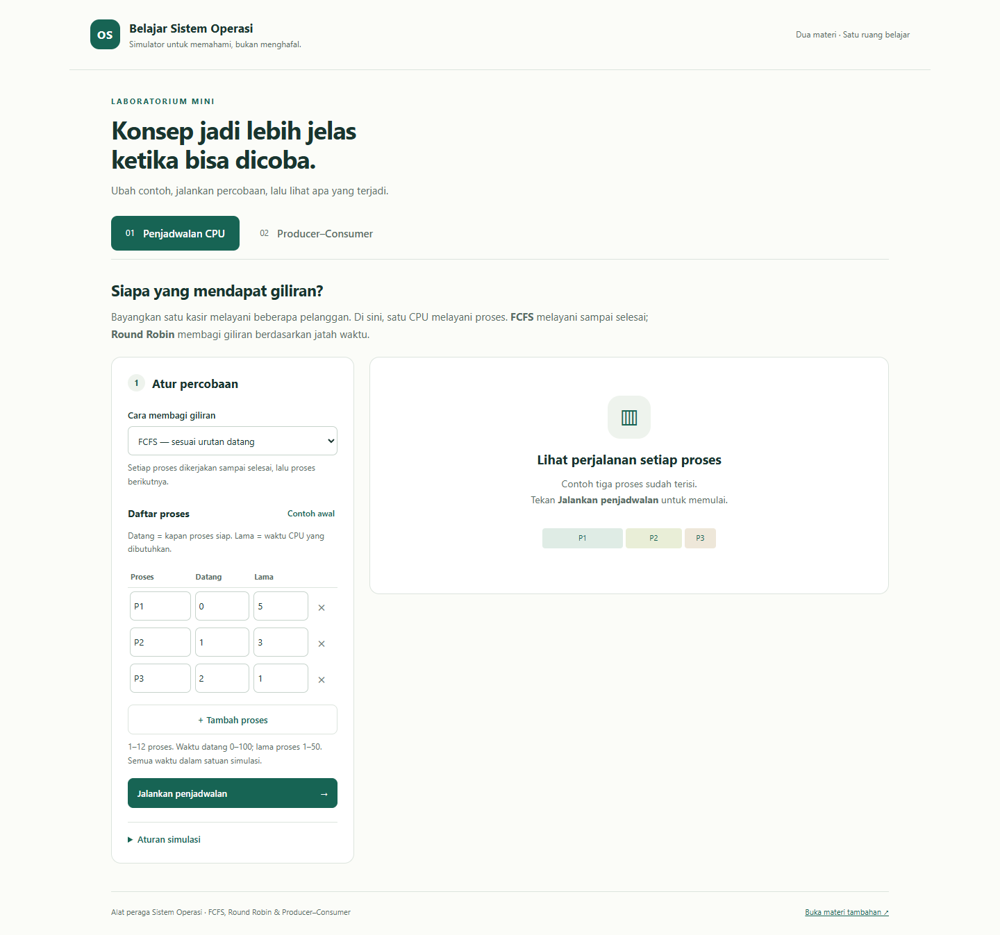
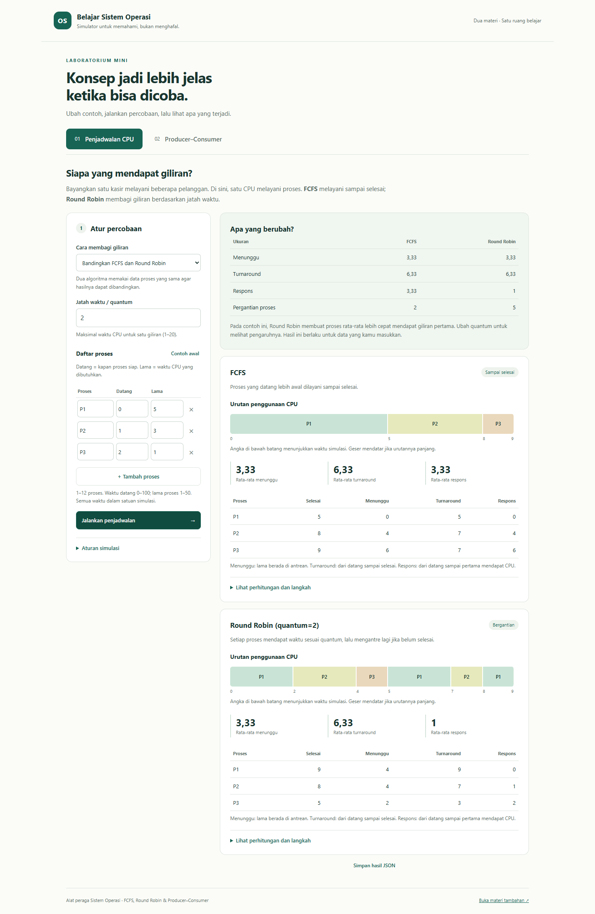
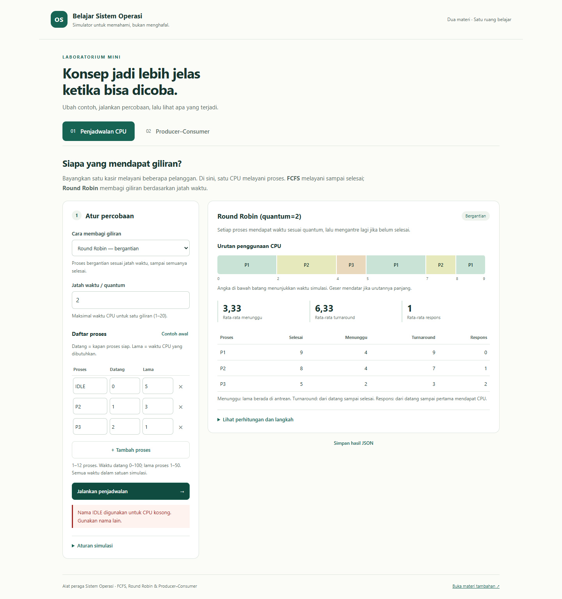
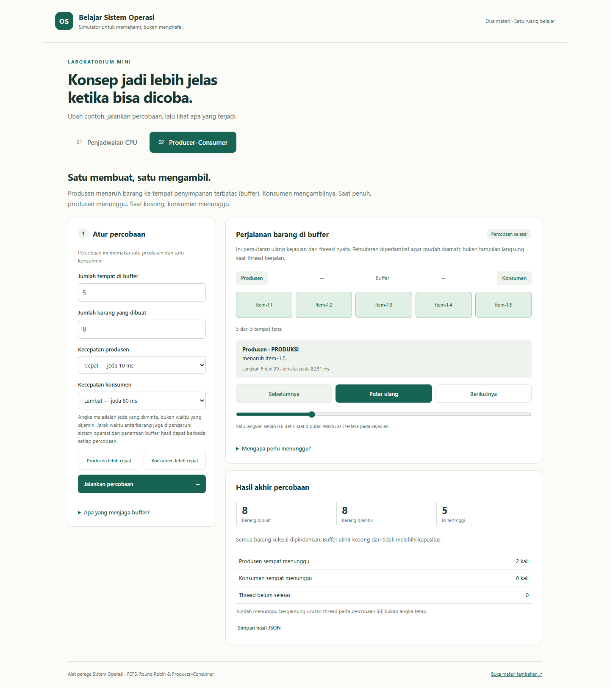
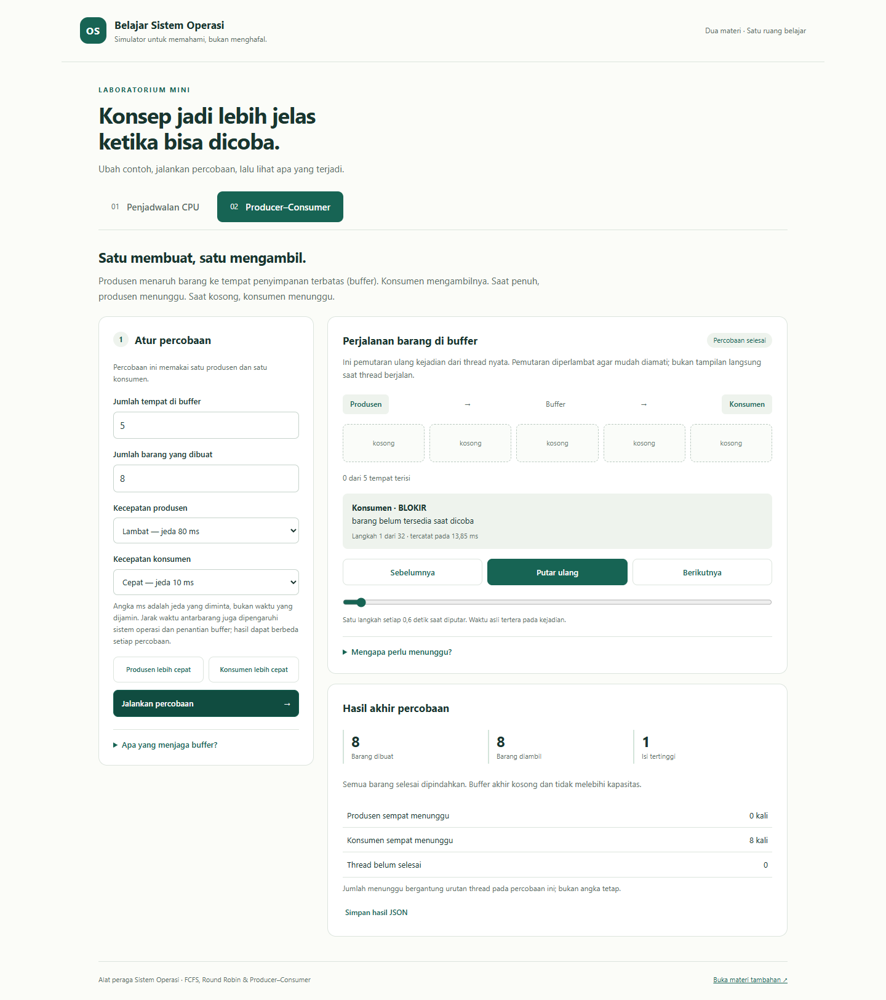

# Panduan Pengguna — Belajar Sistem Operasi

Panduan ini ditulis untuk pembaca yang **belum pernah belajar IT atau
pemrograman**. Anda tidak perlu mengerti kode. Ikuti langkahnya dari atas ke
bawah. Setiap istilah teknis diberi penjelasan bahasa sehari-hari di
sebelahnya.

## Daftar isi

1. [Aplikasi ini sebenarnya apa?](#1-aplikasi-ini-sebenarnya-apa)
2. [Kamus istilah](#2-kamus-istilah)
3. [Cara menjalankan aplikasi](#3-cara-menjalankan-aplikasi)
4. [Mengenal layar utama](#4-mengenal-layar-utama)
5. [Tab 1: Penjadwalan CPU](#5-tab-1-penjadwalan-cpu)
6. [Tab 2: Producer–Consumer](#6-tab-2-producerconsumer)
7. [Halaman materi tambahan](#7-halaman-materi-tambahan)
8. [Pesan kesalahan dan cara memperbaikinya](#8-pesan-kesalahan-dan-cara-memperbaikinya)
9. [Jika aplikasi bermasalah](#9-jika-aplikasi-bermasalah)
10. [Pertanyaan umum](#10-pertanyaan-umum)
11. [Berkas pendukung](#11-berkas-pendukung)

---

## 1. Aplikasi ini sebenarnya apa?

Aplikasi ini adalah **alat peraga**, mirip alat peraga di laboratorium sekolah.
Gunanya memperlihatkan cara kerja komputer di balik layar, yang biasanya tidak
terlihat. Anda mengubah angka, menekan tombol, lalu melihat apa yang terjadi.

Tugas dosen meminta minimal dua materi Sistem Operasi. Aplikasi ini
memperagakan dua materi berikut.

| Materi dalam tugas | Yang diperagakan | Bahasa mudahnya |
|---|---|---|
| **Process Scheduling** | FCFS, Round Robin, Gantt chart, waktu tunggu, turnaround, respons | Komputer punya satu "pekerja" (CPU) yang harus melayani banyak pekerjaan. Materi ini membahas **cara menentukan giliran**: siapa dilayani duluan, dan berapa lama masing-masing harus menunggu. Mirip kasir yang melayani antrean pelanggan. |
| **IPC & Classical Problems** | Producer–Consumer, buffer terbatas, semaphore, mutex | Dua bagian program bekerja bersama memakai satu tempat penyimpanan yang ukurannya terbatas. Satu bagian **menaruh barang**, bagian lain **mengambil barang**. Materi ini membahas **cara mengatur supaya keduanya tidak bertabrakan**: tempat tidak boleh kelebihan isi, dan tidak boleh mengambil dari tempat kosong. Mirip tukang roti yang menaruh roti di rak, dan pembeli yang mengambilnya. |

Penjelasan setiap kata di tabel ini ada di bagian berikutnya.

> **Catatan penting.** Bagian Producer–Consumer memakai *thread* (dua alur
> kerja) di dalam **satu program** yang sama, bukan dua program terpisah. Bagian
> penjadwalan adalah **hitungan simulasi**, bukan pengatur proses yang benar-benar
> berjalan di laptop Anda.

---

## 2. Kamus istilah

Istilah-istilah ini muncul di aplikasi. Kolom kanan adalah bahasa mudahnya.

### Istilah umum

| Istilah | Bahasa mudahnya |
|---|---|
| Sistem Operasi (OS) | Program utama yang mengatur seluruh komputer, misalnya Windows. Ia membagi tenaga komputer ke semua aplikasi yang sedang dibuka. |
| Program | Kumpulan perintah yang disimpan di komputer, misalnya aplikasi kalkulator yang belum dibuka. |
| Proses | Program yang **sedang berjalan**. Kalkulator yang sedang dibuka adalah sebuah proses. Di aplikasi ini, proses diberi nama P1, P2, P3, dan seterusnya. |
| CPU | "Otak" komputer yang mengerjakan perintah. Pada aplikasi ini dianggap hanya ada **satu** CPU, sehingga hanya satu proses yang bisa dikerjakan pada satu waktu. |
| Simulasi | Tiruan. Aplikasi menghitung apa yang *akan* terjadi menurut aturan tertentu, tanpa benar-benar mengatur laptop Anda. |
| Satuan waktu simulasi | Satuan waktu khayalan di bagian penjadwalan. Angka 5 berarti "5 satuan", bukan 5 detik. |
| ms (milidetik) | Seperseribu detik. 10 ms = 0,01 detik, jauh lebih cepat dari kedipan mata. |
| Server | Bagian aplikasi yang bekerja di belakang layar (di jendela hitam) dan mengerjakan semua hitungan. |
| Browser | Aplikasi untuk membuka halaman web, misalnya Chrome atau Edge. Tampilan aplikasi ini dibuka lewat browser. |
| JSON | Format berkas berisi data hasil percobaan. Berguna untuk arsip; tidak perlu dibuka jika Anda tidak membutuhkannya. |

### Istilah di tab Penjadwalan CPU

| Istilah | Bahasa mudahnya |
|---|---|
| Penjadwalan (scheduling) | Aturan untuk menentukan proses mana yang dikerjakan CPU berikutnya. Seperti aturan antrean di loket. |
| Algoritma | Langkah-langkah atau aturan yang diikuti, mirip resep masakan. |
| FCFS (First Come First Served) | "Yang datang duluan, dilayani duluan, **sampai selesai**." Seperti kasir yang menyelesaikan satu pelanggan dulu sebelum memanggil pelanggan berikutnya. |
| Round Robin (RR) | "**Bergiliran** dengan jatah waktu yang sama." Seperti beberapa anak yang bergantian memakai satu mainan, masing-masing dua menit. Yang belum puas kembali mengantre di belakang. |
| Quantum (jatah waktu) | Panjang satu giliran pada Round Robin. Quantum 2 berarti setiap proses boleh dikerjakan paling lama 2 satuan waktu, lalu harus gantian. |
| Datang (arrival) | Kapan proses tiba dan mulai ikut antre. Datang 0 berarti sudah ada sejak awal. |
| Lama (burst) | Berapa lama proses itu perlu dikerjakan CPU sampai tuntas. |
| Selesai (completion) | Pada waktu ke berapa proses itu tuntas dikerjakan. |
| Menunggu (waiting time) | Total waktu proses **sudah antre tetapi belum dikerjakan**. Makin kecil makin baik. |
| Turnaround | Lama total dari proses **datang sampai selesai**, termasuk waktu menunggu dan waktu dikerjakan. |
| Respons (response time) | Berapa lama proses menunggu sampai **pertama kali** disentuh CPU. Seperti lamanya menunggu sampai pelayan restoran pertama kali menghampiri meja Anda. |
| Rata-rata | Jumlah nilai semua proses dibagi banyaknya proses. |
| Gantt chart | Diagram batang mendatar yang menunjukkan **siapa dikerjakan CPU, dari waktu ke berapa sampai ke berapa**. Seperti jadwal pelajaran yang digambar sebagai garis waktu. |
| IDLE | CPU **menganggur** karena belum ada proses yang datang. Nama "IDLE" dipakai khusus untuk ini, jadi tidak boleh dipakai sebagai nama proses. |
| Pergantian proses (context switch) | Saat CPU berpindah dari mengerjakan satu proses ke proses lain. Di dunia nyata, setiap perpindahan memakan sedikit waktu. Aplikasi ini menghitung jumlahnya saja, tidak menghitung waktunya. |
| Antrean (queue) | Barisan proses yang menunggu giliran. |

### Istilah di tab Producer–Consumer

| Istilah | Bahasa mudahnya |
|---|---|
| Thread | Satu "alur kerja" di dalam program. Bayangkan dua karyawan di satu toko: mereka bekerja bersamaan dan memakai barang yang sama. |
| Producer (produsen) | Thread yang **membuat dan menaruh** barang. Ibarat tukang roti. |
| Consumer (konsumen) | Thread yang **mengambil** barang. Ibarat pembeli roti. |
| Buffer | **Tempat penyimpanan sementara** di antara produsen dan konsumen. Ibarat rak roti. |
| Buffer terbatas (bounded buffer) | Rak yang jumlah tempatnya terbatas, misalnya hanya muat 5 roti. |
| Barang (item) | Benda yang dipindahkan, diberi label seperti **item-1.3**, artinya barang ke-3 buatan produsen nomor 1. |
| Sinkronisasi | Pengaturan supaya beberapa thread bekerja tertib, tidak saling mengganggu. Seperti lampu lalu lintas di perempatan. |
| Semaphore | **Penghitung izin.** Ibarat papan "tempat parkir kosong: 3". Mobil boleh masuk selama angkanya lebih dari 0; kalau 0, mobil menunggu. |
| Semaphore kosong (*empty*) | Menghitung **tempat kosong** di rak. Produsen hanya boleh menaruh barang jika masih ada tempat kosong. |
| Semaphore terisi (*full*) | Menghitung **barang yang siap diambil**. Konsumen hanya boleh mengambil jika memang ada barang. |
| Mutex | **Kunci satu-satunya.** Ibarat kunci kamar pas di toko baju: hanya pemegang kunci yang boleh masuk, yang lain menunggu. Di sini mutex memastikan hanya satu thread yang mengubah isi rak pada satu waktu. |
| Menunggu / BLOKIR | Thread berhenti sebentar karena izinnya belum ada: produsen menunggu karena rak penuh, atau konsumen menunggu karena rak kosong. **Ini normal, bukan error.** |
| Deadlock | Keadaan **saling menunggu selamanya** sehingga semuanya macet. Seperti dua mobil berhadapan di jalan sempit dan tidak ada yang mau mundur. Aplikasi ini dirancang supaya tidak terjadi. |
| Rekaman (log) | Catatan urutan kejadian selama percobaan, lengkap dengan isi rak di setiap langkah. |
| Pemutaran ulang (replay) | Rekaman tadi diputar pelan-pelan di layar supaya mudah diikuti, seperti menonton ulang video. |
| IPC (Inter-Process Communication) | Cara bagian-bagian program saling bertukar data. Di aplikasi ini ditunjukkan lewat masalah Producer–Consumer. |
| Classical Problems | "Soal klasik" yang sering dipakai untuk mengajarkan sinkronisasi. Producer–Consumer adalah salah satunya. |

---

## 3. Cara menjalankan aplikasi

Aplikasi berjalan **di laptop sendiri**. Tidak perlu internet, tidak perlu
membuat akun, dan tidak perlu memasang program tambahan.

### Langkah 1 — Siapkan folder

Jika Anda menerima berkas **Proyek-Blessya.zip**, ekstrak dulu:

1. Klik kanan berkas ZIP, lalu pilih **Extract All…** (Ekstrak Semua).
2. Tekan **Extract**. Akan muncul folder **Proyek-Blessya**.

> Jangan menjalankan aplikasi langsung dari dalam ZIP tanpa diekstrak.
> Windows tidak bisa menjalankan program dengan benar dari dalam ZIP.

### Langkah 2 — Klik dua kali `mulai.bat`

Buka folder **Proyek-Blessya**, lalu klik dua kali berkas **mulai.bat**. Ikon
berkas ini biasanya bergambar roda gigi.

Yang terjadi setelahnya:

1. Muncul **jendela hitam** (terminal). Inilah *server*, mesin penghitung
   aplikasi. Isinya kurang lebih:

   ```text
   ================================================================
     SIMULATOR SISTEM OPERASI
   ================================================================
     Server berjalan di : http://127.0.0.1:8000
     Buka alamat di atas dengan browser (Chrome/Edge/Firefox).
     Tekan Ctrl+C di jendela ini untuk menghentikan server.
   ================================================================
   ```

2. Sekitar satu detik kemudian, **browser terbuka otomatis** dan menampilkan
   aplikasi.

> Jika Windows menampilkan peringatan keamanan saat membuka `mulai.bat`, itu
> karena berkasnya berasal dari ZIP. Pilih **Run** atau **More info → Run
> anyway**, tetapi hanya untuk folder proyek ini yang Anda terima dari sumber
> yang Anda percaya.

### Langkah 3 — Biarkan jendela hitam tetap terbuka

**Jangan tutup jendela hitam** selama memakai aplikasi. Kalau jendela ini
ditutup, tombol-tombol di browser tidak akan bekerja dan muncul pesan "Server
tidak terhubung".

Selama dipakai, jendela hitam akan menampilkan baris-baris seperti
`[server] "POST /api/scheduling HTTP/1.1" 200 -`. Itu catatan normal setiap kali
Anda menekan tombol hijau. Angka **200** berarti permintaan berhasil; angka
**400** berarti ada isian yang ditolak (pesannya juga muncul di browser).

### Langkah 4 — Jika browser tidak terbuka sendiri

Buka Chrome atau Edge, lalu ketik alamat ini di kolom alamat paling atas:

```text
http://127.0.0.1:8000
```

Tekan Enter. Alamat `127.0.0.1` artinya "laptop ini sendiri". Aplikasi tidak
dikirim ke internet.

### Langkah 5 — Menutup aplikasi

1. Tutup tab browser.
2. Klik jendela hitam, lalu tekan tombol **Ctrl** dan **C** bersamaan. Server
   berhenti. Setelah itu jendela boleh ditutup.

---

## 4. Mengenal layar utama



| Bagian layar | Letak | Fungsinya |
|---|---|---|
| Logo **OS** dan tulisan *Belajar Sistem Operasi* | Kiri atas | Nama aplikasi. Klik untuk kembali ke tampilan awal (halaman dimuat ulang, semua isian kembali ke contoh awal). |
| *Dua materi · Satu ruang belajar* | Kanan atas | Hiasan keterangan saja, tidak bisa diklik. |
| Judul besar *Konsep jadi lebih jelas ketika bisa dicoba* | Atas | Kalimat pembuka. |
| Tombol tab **01 Penjadwalan CPU** | Di bawah judul | Membuka materi pertama. Tab yang aktif berwarna hijau tua. |
| Tombol tab **02 Producer–Consumer** | Di sebelah tab 01 | Membuka materi kedua. |
| Kotak **1 Atur percobaan** | Kiri | Tempat Anda **mengisi** data dan memilih pengaturan. |
| Kotak hasil | Kanan | Tempat **hasil** muncul setelah tombol hijau ditekan. Sebelum ditekan, isinya hanya petunjuk. |
| *Buka materi tambahan ↗* | Paling bawah, kanan | Membuka halaman berisi materi tambahan (lihat bagian 7). Tidak wajib untuk dua materi utama. |

**Kenapa ada dua tab?** Karena tugas meminta dua materi. Setiap tab adalah satu
materi. Berpindah tab tidak menghapus isian di tab lainnya, tetapi pemutaran
rekaman di tab Producer–Consumer akan berhenti.

**Di layar ponsel** atau jendela sempit, kotak kiri dan kanan disusun
bertumpuk: pengaturan di atas, hasil di bawah. Gulir ke bawah untuk melihat
hasil.

---

## 5. Tab 1: Penjadwalan CPU

### 5.1 Ceritanya

Bayangkan **satu kasir** (CPU) dan beberapa **pelanggan** (proses: P1, P2, P3).
Setiap pelanggan datang pada waktu berbeda dan butuh dilayani dalam lama yang
berbeda. Pertanyaannya: **siapa dilayani duluan, dan berapa lama yang lain
harus menunggu?**

Tab ini membandingkan dua aturan:

- **FCFS**: pelanggan pertama dilayani sampai selesai, baru pelanggan berikutnya.
- **Round Robin**: setiap pelanggan dilayani sebentar (sesuai jatah waktu), lalu
  gantian. Yang belum selesai kembali antre di belakang.

### 5.2 Kotak kiri: "Atur percobaan"

Isi kotak ini dari atas ke bawah.

| Yang terlihat di layar | Apa itu | Apa yang terjadi jika diubah atau ditekan | Kenapa perlu |
|---|---|---|---|
| **Cara membagi giliran** (kotak pilihan) | Memilih aturan antrean | Klik untuk membuka tiga pilihan (lihat tabel di bawah). Tulisan kecil di bawahnya ikut berubah menjelaskan pilihan itu. | Supaya Anda bisa melihat bedanya aturan FCFS dan Round Robin. |
| **Jatah waktu / quantum** (kotak angka) | Panjang satu giliran Round Robin | Hanya **muncul** jika Anda memilih Round Robin atau Bandingkan. Isi angka bulat 1–20. Awalnya 2. | Quantum menentukan seberapa sering proses bergantian. Coba ubah-ubah untuk melihat pengaruhnya. |
| **Daftar proses** (tabel) | Data pelanggan yang akan dilayani | Setiap baris adalah satu proses. Anda boleh mengetik ulang isinya. | Inilah data yang dihitung. Mengubahnya akan mengubah hasil. |
| Kolom **Proses** | Nama proses | Ketik nama bebas, maksimal 12 huruf, misalnya P1 atau Word. Nama tidak boleh kembar dan tidak boleh "IDLE". | Nama dipakai sebagai label di diagram dan tabel hasil. |
| Kolom **Datang** | Waktu proses tiba | Isi angka bulat 0–100. Panah kecil di kanan kotak menambah/mengurangi 1. | Menentukan kapan proses mulai ikut antre. |
| Kolom **Lama** | Lama proses dikerjakan | Isi angka bulat 1–50. | Menentukan berapa lama CPU harus mengerjakan proses itu. |
| Tombol **×** di ujung baris | Hapus baris | Baris itu langsung hilang. Minimal harus tersisa satu proses. | Untuk mengurangi jumlah proses. |
| Tombol **Contoh awal** | Kembalikan contoh | Tabel kembali berisi P1 (datang 0, lama 5), P2 (datang 1, lama 3), dan P3 (datang 2, lama 1). | Jika isian sudah kacau dan Anda ingin mulai lagi dari contoh bawaan. |
| Tombol **+ Tambah proses** | Tambah baris | Muncul baris baru dengan nama berikutnya yang belum dipakai (misalnya P4), datang 0, lama 2. Maksimal 12 proses. | Untuk mencoba antrean yang lebih panjang. |
| Tombol hijau **Jalankan penjadwalan →** | Mulai menghitung | Data dikirim ke server dan dihitung. Sesaat muncul tulisan *Menghitung urutan proses…*, lalu hasil tampil di kanan. Selama menghitung, semua isian dikunci sebentar. | Hasil **tidak** berubah sendiri saat Anda mengetik. Anda harus menekan tombol ini setiap kali selesai mengubah data. |
| **▸ Aturan simulasi** | Keterangan tersembunyi | Klik untuk membuka atau menutup penjelasan aturan yang dipakai. | Menjelaskan batasan simulasi, misalnya hanya satu CPU dan waktu pergantian tidak dihitung. |

**Tiga pilihan pada "Cara membagi giliran":**

| Pilihan | Artinya | Hasil yang tampil |
|---|---|---|
| FCFS — sesuai urutan datang | Yang datang duluan dilayani sampai selesai | Satu kotak hasil FCFS |
| Round Robin — bergantian | Bergiliran sesuai quantum | Satu kotak hasil Round Robin |
| Bandingkan FCFS dan Round Robin | Menghitung keduanya dengan data yang sama | Tabel perbandingan **Apa yang berubah?**, lalu kotak FCFS dan kotak Round Robin |

### 5.3 Kotak kanan: membaca hasil



Hasil terdiri dari beberapa bagian, dari atas ke bawah.

| Bagian hasil | Apa artinya | Cara membacanya |
|---|---|---|
| **Apa yang berubah?** (hanya mode Bandingkan) | Tabel ringkas FCFS vs Round Robin | Bandingkan angka di kolom FCFS dan kolom Round Robin pada baris yang sama. Kalimat di bawah tabel menyimpulkan mana yang membuat proses lebih cepat mendapat giliran pertama. |
| Judul **FCFS** atau **Round Robin (quantum=2)** | Aturan yang dipakai | Label kecil di kanan: *Sampai selesai* untuk FCFS, *Bergantian* untuk Round Robin. |
| **Urutan penggunaan CPU** (Gantt chart) | Siapa dikerjakan, kapan | Baca dari **kiri ke kanan** seperti garis waktu. Setiap kotak berwarna = satu proses sedang dikerjakan. Angka di bawah batang = waktu mulai dan selesai. Kotak abu-abu muda bertuliskan IDLE = CPU menganggur. |
| Arahkan mouse ke sebuah batang | Keterangan rinci | Muncul tulisan kecil, misalnya *P2: 5 sampai 8, durasi 3*. |
| Batang terlalu panjang | — | Geser area diagram ke kanan (dengan touchpad atau scroll mendatar). Urutannya tidak berubah. |
| Tiga angka besar | Rata-rata menunggu, rata-rata turnaround, rata-rata respons | Ringkasan untuk semua proses. **Makin kecil makin baik** untuk ketiganya. |
| Tabel **Proses / Selesai / Menunggu / Turnaround / Respons** | Angka setiap proses | Satu baris untuk satu proses. Tabel diurutkan menurut nama, **bukan** menurut urutan dikerjakan; urutan dikerjakan lihat di diagram. |
| **▸ Lihat perhitungan dan langkah** | Rincian cara menghitung | Klik untuk membuka rumus, jumlah **pergantian antarproses**, dan langkah demi langkah keputusan CPU, misalnya *t=2: quantum P1 habis, sisa 3. Dipindah ke belakang antrian -> [P2, P3, P1].* (huruf *t* = waktu). |
| Tombol **Simpan hasil JSON** | Unduh data hasil | Browser mengunduh berkas **hasil-penjadwalan.json** ke folder Unduhan. | Untuk arsip atau lampiran. Tidak wajib. |

### 5.4 Contoh membaca satu angka

Ambil **P2 pada FCFS** dengan contoh awal. P2 datang pada waktu 1, butuh lama 3.
Di diagram, P2 dikerjakan dari waktu 5 sampai 8.

| Yang dihitung | Rumus | Hasil | Bahasa mudahnya |
|---|---|---|---|
| Turnaround | selesai − datang = 8 − 1 | **7** | Sejak datang sampai beres, P2 butuh 7 satuan waktu. |
| Menunggu | turnaround − lama = 7 − 3 | **4** | Dari 7 satuan itu, 3 dipakai untuk dikerjakan, jadi 4 sisanya hanya menunggu. |
| Respons | mulai pertama − datang = 5 − 1 | **4** | P2 menunggu 4 satuan sampai pertama kali dilayani. |

Pada FCFS, menunggu dan respons sering sama karena proses hanya dilayani satu
kali. Pada Round Robin bisa berbeda, karena proses dilayani beberapa kali.

### 5.5 Percobaan yang disarankan

Lakukan berurutan. Angka di kolom "Hasil yang akan terlihat" sudah dicocokkan
dengan aplikasi.

| No. | Langkah | Hasil yang akan terlihat | Pelajaran |
|---|---|---|---|
| 1 | Biarkan **FCFS** dan contoh awal. Tekan **Jalankan penjadwalan**. | Diagram: P1 0–5, P2 5–8, P3 8–9. Rata-rata menunggu 3,33; turnaround 6,33; respons 3,33. | FCFS melayani sesuai urutan datang, sampai selesai. |
| 2 | Pilih **Bandingkan FCFS dan Round Robin**, quantum **2**. Tekan tombol hijau. | Rata-rata respons FCFS 3,33, Round Robin **1**. Rata-rata menunggu keduanya tetap 3,33. Pergantian proses: 2 dan 5. | Round Robin membuat setiap proses **lebih cepat disentuh pertama kali**, tetapi CPU lebih sering berganti. |
| 3 | Ubah quantum menjadi **1**. Tekan tombol hijau. | Round Robin: respons 0,33, menunggu 2,67, pergantian 7. | Jatah makin kecil, giliran makin sering. |
| 4 | Ubah quantum menjadi **5**. Tekan tombol hijau. | Hasil Round Robin **sama persis** dengan FCFS. | Jika jatah waktu cukup besar untuk menyelesaikan setiap proses sekaligus, Round Robin berperilaku seperti FCFS. |
| 5 | Tekan **Contoh awal**. Ubah **Lama** P1 menjadi **24**. Tetap mode Bandingkan, quantum 2. | FCFS: P2 menunggu 23, P3 menunggu 25, rata-rata menunggu **16**. Round Robin: rata-rata menunggu **3,33**. | Satu pekerjaan panjang di depan membuat yang lain menunggu sangat lama pada FCFS (disebut *convoy effect*, "efek iring-iringan"). Round Robin mencegahnya. |
| 6 | Tekan **Contoh awal**. Hapus P2 dan P3 dengan tombol **×**. Ubah **Datang** P1 menjadi **5**. Pilih FCFS. | Diagram diawali kotak **IDLE** dari 0 sampai 5, lalu P1 5–8. | CPU menganggur karena belum ada proses yang datang. |
| 7 | Ganti nama salah satu proses menjadi **IDLE**, lalu tekan tombol hijau. | Muncul pesan merah: *Nama IDLE digunakan untuk CPU kosong. Gunakan nama lain.* | Aplikasi menolak isian yang salah dan memberi tahu cara memperbaikinya. |

> Pada percobaan 7, hasil di sebelah kanan **tidak berubah**: yang tampil masih
> hasil percobaan sebelumnya. Perbaiki isian, lalu tekan tombol hijau lagi.



**Kenapa tidak ada aturan yang "paling baik"?** Pada percobaan 2, Round Robin
unggul dalam respons, tetapi waktu tunggu rata-ratanya sama dengan FCFS dan
pergantiannya lebih banyak. Aturan yang cocok bergantung pada apa yang paling
penting.

---

## 6. Tab 2: Producer–Consumer

### 6.1 Ceritanya

Bayangkan **toko roti**:

- **Tukang roti** (produsen) membuat roti satu per satu dan menaruhnya di **rak**.
- **Rak** (buffer) hanya punya beberapa tempat, misalnya 5.
- **Pembeli** (konsumen) mengambil roti dari rak, satu per satu, dari yang
  paling lama ditaruh.

Dua aturan penting:

1. Jika rak **penuh**, tukang roti harus **menunggu** sampai ada roti diambil.
2. Jika rak **kosong**, pembeli harus **menunggu** sampai ada roti baru.

Tab ini menjalankan tukang roti dan pembeli sebagai dua *thread* yang
benar-benar bekerja bersamaan di komputer. Setelah selesai, kejadiannya diputar
ulang pelan-pelan di layar supaya mudah diikuti.

### 6.2 Kotak kiri: "Atur percobaan"

| Yang terlihat di layar | Apa itu | Apa yang terjadi jika diubah atau ditekan | Kenapa perlu |
|---|---|---|---|
| Tulisan *Percobaan ini memakai satu produsen dan satu konsumen* | Keterangan | Tidak bisa diubah. | Satu tukang roti dan satu pembeli supaya mudah diamati. |
| **Jumlah tempat di buffer** | Ukuran rak | Isi angka bulat 1–10. Awalnya 5. Menentukan jumlah kotak yang tampil di hasil. | Rak kecil lebih cepat penuh, sehingga tukang roti lebih sering menunggu. |
| **Jumlah barang yang dibuat** | Total roti yang akan dibuat | Isi angka bulat 1–12. Awalnya 8. | Percobaan selesai setelah semua barang dibuat **dan** diambil. |
| **Kecepatan produsen** (kotak pilihan) | Seberapa cepat tukang roti bekerja | Pilihan: *Cepat — jeda 10 ms*, *Sedang — jeda 40 ms*, *Lambat — jeda 80 ms*. Awalnya Cepat. | Jeda = istirahat sebelum membuat barang berikutnya. Jeda kecil berarti lebih cepat. |
| **Kecepatan konsumen** (kotak pilihan) | Seberapa cepat pembeli bekerja | Pilihan sama. Awalnya Lambat. | Perbedaan kecepatan keduanya menentukan siapa yang lebih sering menunggu. |
| Tulisan kecil tentang *ms* | Peringatan | Tidak bisa diklik. | Angka ms adalah istirahat yang **diminta**. Waktu sebenarnya bisa sedikit lebih lama karena komputer juga mengatur giliran thread. Karena itu hasil bisa berbeda tiap percobaan. |
| Tombol **Produsen lebih cepat** | Jalan pintas pengaturan | Mengatur produsen ke *Cepat 10 ms* dan konsumen ke *Lambat 80 ms*. **Belum** menjalankan percobaan. | Cara cepat menyiapkan skenario "rak cepat penuh". |
| Tombol **Konsumen lebih cepat** | Jalan pintas pengaturan | Mengatur produsen ke *Lambat 80 ms* dan konsumen ke *Cepat 10 ms*. **Belum** menjalankan percobaan. | Cara cepat menyiapkan skenario "rak sering kosong". |
| Tombol hijau **Jalankan percobaan →** | Mulai percobaan | Muncul tulisan *Produsen dan konsumen sedang bekerja…* sekitar satu detik, lalu hasil tampil di kanan. Selama berjalan, isian dikunci. | Thread baru benar-benar dijalankan saat tombol ini ditekan. Setiap kali ditekan, percobaan diulang dari awal. |
| **▸ Apa yang menjaga buffer?** | Keterangan tersembunyi | Klik untuk membuka penjelasan semaphore dan mutex. | Menjelaskan "penjaga" yang membuat rak tidak kelebihan isi. |

### 6.3 Kotak kanan: "Perjalanan barang di buffer"



| Bagian hasil | Apa artinya | Cara membacanya |
|---|---|---|
| Label **Percobaan selesai** | Percobaan berhasil dijalankan | Muncul jika semua barang sudah dipindahkan. |
| Tulisan *Ini pemutaran ulang…* | Pengingat | Yang Anda tonton adalah **rekaman** setelah thread selesai, bukan siaran langsung. |
| **Produsen → Buffer → Konsumen** | Arah perjalanan barang | Barang selalu bergerak dari produsen, masuk rak, lalu diambil konsumen. |
| Kotak-kotak di tengah | Tempat-tempat di rak | Kotak **hijau berlabel** (misalnya *item-1.3*) = berisi barang. Kotak bergaris putus-putus bertuliskan **kosong** = tempat masih tersedia. Barang paling kiri adalah yang paling lama ditaruh dan akan diambil lebih dulu. |
| *x dari y tempat terisi* | Jumlah isi rak saat ini | Misalnya *5 dari 5 tempat terisi* berarti rak penuh. |
| Kotak keterangan kejadian | Apa yang baru terjadi | Baris pertama: **siapa · tindakan**, misalnya *Produsen · PRODUKSI*. Baris kedua: rinciannya, misalnya *menaruh item-1.5*. Baris kecil: *Langkah 5 dari 20 · tercatat pada 82,91 ms* (urutan kejadian dan waktu aslinya sejak percobaan dimulai). |
| Tombol **Sebelumnya** | Mundur satu langkah | Rak kembali ke keadaan satu kejadian sebelumnya. Tidak bisa ditekan di langkah awal. | Untuk melihat ulang kejadian yang terlewat. |
| Tombol **Putar ulang** | Putar otomatis | Rekaman maju sendiri, satu langkah setiap 0,6 detik. Saat berjalan, tombol berubah menjadi **Jeda**; tekan lagi untuk berhenti. Jika sudah di akhir, menekannya memutar dari awal. | Untuk menonton seluruh kejadian tanpa menekan tombol berkali-kali. |
| Tombol **Berikutnya** | Maju satu langkah | Rak berubah sesuai kejadian berikutnya. Tidak bisa ditekan di langkah terakhir. | Untuk mempelajari kejadian satu per satu dengan tenang. |
| Garis geser (slider) | Lompat ke langkah tertentu | Tarik titik bulat ke kiri atau kanan. | Untuk langsung menuju bagian yang menarik. |
| **▸ Mengapa perlu menunggu?** | Keterangan tersembunyi | Klik untuk membuka penjelasan. | Menjelaskan kenapa produsen atau konsumen kadang harus berhenti. |

**Arti tindakan pada kotak keterangan:**

| Tindakan | Artinya | Bahasa mudahnya |
|---|---|---|
| **PRODUKSI** | Produsen menaruh satu barang di buffer | Tukang roti menaruh satu roti di rak. |
| **KONSUMSI** | Konsumen mengambil satu barang dari buffer | Pembeli mengambil roti paling lama dari rak. |
| **BLOKIR** | Thread harus menunggu karena izinnya belum ada | Produsen: *slot kosong belum tersedia* (rak penuh). Konsumen: *barang belum tersedia* (rak kosong). Normal, bukan error. |
| **LANJUT** | Izin sudah didapat, thread bekerja lagi | Ada tempat kosong atau ada roti lagi, jadi yang menunggu boleh melanjutkan. |

### 6.4 Kotak "Hasil akhir percobaan"

| Yang terlihat | Artinya | Hasil yang benar |
|---|---|---|
| **Barang dibuat** | Jumlah barang yang ditaruh produsen | Sama dengan isian *Jumlah barang yang dibuat* |
| **Barang diambil** | Jumlah barang yang diambil konsumen | Sama dengan barang dibuat (tidak ada yang hilang) |
| **Isi tertinggi** | Isi rak paling banyak selama percobaan | Tidak pernah melebihi jumlah tempat di buffer |
| **Produsen sempat menunggu** | Berapa kali produsen menemukan rak penuh | Boleh berapa saja |
| **Konsumen sempat menunggu** | Berapa kali konsumen menemukan rak kosong | Boleh berapa saja |
| **Thread belum selesai** | Thread yang masih macet di akhir | Harus **0** |
| Tombol **Simpan hasil JSON** | Unduh data percobaan | Browser mengunduh **hasil-producer-consumer.json** |

**Kenapa angka "sempat menunggu" bisa berubah setiap kali dijalankan?** Karena
komputer sendiri yang memutuskan kapan setiap thread mendapat giliran, dan
keputusan itu tidak selalu sama. Yang **harus selalu sama** adalah: barang
dibuat = barang diambil, isi tertinggi tidak melebihi kapasitas, dan thread
belum selesai = 0.

### 6.5 Percobaan yang disarankan

| No. | Langkah | Yang akan terlihat | Pelajaran |
|---|---|---|---|
| 1 | Biarkan tempat 5, barang 8. Tekan **Produsen lebih cepat**, lalu **Jalankan percobaan**. Tekan **Putar ulang**. | Rak cepat terisi sampai **5 dari 5**. Lalu muncul *Produsen · BLOKIR — slot kosong belum tersedia*. Isi tertinggi 5. | Saat rak penuh, produsen harus menunggu. Semaphore *kosong* yang menahannya. |
| 2 | Tekan **Konsumen lebih cepat**, lalu **Jalankan percobaan**. Tekan **Berikutnya** beberapa kali. | Langkah awal: *Konsumen · BLOKIR — barang belum tersedia*. Rak hampir selalu kosong; isi tertinggi biasanya 1. Konsumen sempat menunggu beberapa kali. | Saat rak kosong, konsumen harus menunggu. Semaphore *terisi* yang menahannya. |
| 3 | Ubah **Jumlah tempat di buffer** menjadi **1**. Pilih produsen Cepat, konsumen Lambat. Jalankan. | Rak penuh setelah satu barang; produsen sering menunggu. | Rak yang kecil membuat produsen lebih sering menunggu. |
| 4 | Pilih kecepatan **Sedang** untuk keduanya. Jalankan tiga kali. | Barang dibuat dan diambil selalu 8, tetapi angka "sempat menunggu" bisa berbeda. | Thread berjalan sungguhan; urutan detailnya ditentukan komputer. |



---

## 7. Halaman materi tambahan

Klik **Buka materi tambahan ↗** di bagian paling bawah halaman utama. Halaman ini
berisi materi dari versi awal proyek. **Tidak wajib** untuk memahami dua materi
utama, tetapi boleh dicoba. Untuk kembali, tekan tombol **Back** (panah kiri) di
browser.

Saat dibuka, bagian penjadwalan langsung menjalankan contoh sekali, sehingga
hasilnya sudah tampil tanpa perlu menekan apa pun.

Halaman ini punya empat tab di bagian atas.

### Tab "1. Penjadwalan Proses"

Membandingkan **lima** aturan antrean sekaligus pada data yang sama.

| Yang terlihat | Fungsinya / bahasa mudahnya |
|---|---|
| Tabel **Data Proses** (Proses, Arrival, Burst, Prioritas) | Sama seperti daftar proses di halaman utama. *Arrival* = datang, *Burst* = lama, *Prioritas* = tingkat kepentingan (angka **kecil = lebih penting**). |
| **+ Tambah proses** / **Kembalikan contoh** | Menambah baris (maksimal 12) / mengembalikan contoh empat proses. |
| **Time quantum (Round Robin)** | Jatah waktu untuk Round Robin. Awalnya 3. |
| **Jalankan semua algoritma** | Menghitung kelima aturan sekaligus. |
| **Tabel Perbandingan** | Satu baris per aturan: *Avg Waiting* (rata-rata menunggu), *Avg Turnaround*, *Avg Response* (rata-rata respons), *Utilisasi CPU* (persentase waktu CPU bekerja), *Context Switch* (jumlah pergantian). Baris yang disorot = rata-rata menunggu terkecil. |
| **Hasil Rinci per Algoritma** | Diagram dan tabel untuk tiap aturan, plus tombol *Lihat keputusan scheduler langkah demi langkah*. |

Lima aturan yang dibandingkan:

| Aturan | Bahasa mudahnya |
|---|---|
| FCFS | Datang duluan, dilayani duluan sampai selesai. |
| SJF (Shortest Job First) | Pekerjaan **paling singkat** didahulukan, dan tidak dipotong. |
| SRTF (Shortest Remaining Time First) | Seperti SJF, tetapi boleh **memotong**: jika datang pekerjaan yang sisanya lebih singkat, ia langsung didahulukan. |
| Round Robin | Bergiliran sesuai jatah waktu. |
| Priority | Yang **paling penting** (angka prioritas terkecil) didahulukan. |

### Tab "2. Thread & IPC"

| Percobaan | Isian dan tombol | Yang diperlihatkan |
|---|---|---|
| **A. Race Condition** | *Jumlah thread*, *Increment per thread* (berapa kali tiap thread menambah angka), *Percobaan* (berapa kali diulang), centang *Paksa perpindahan thread*, tombol **Jalankan**. | Beberapa thread menambah satu angka yang sama. **Tanpa lock**, sebagian tambahan hilang karena thread saling menimpa (seperti dua orang menulis di papan tulis yang sama bersamaan). **Dengan lock** (mutex), hasilnya selalu benar. Kolom *Hilang* dan *Rusak* menunjukkan berapa yang hilang. Jika centang dimatikan, kesalahan bisa tidak muncul walaupun programnya tetap salah. |
| **B. Producer–Consumer** | *Kapasitas buffer*, *Produsen* (1–5), *Konsumen* (1–5), *Barang / produsen*, tombol **Jalankan**. | Versi dengan **banyak** produsen dan konsumen. Ditampilkan sebagai daftar kejadian: kotak biru = tempat terisi, label PRODUKSI, KONSUMSI, BLOKIR, LANJUT. |
| **C. Dining Philosophers** | *Target makan / filsuf*, tombol **Bandingkan 3 strategi**. | Soal klasik: lima filsuf duduk melingkar dengan lima garpu, dan setiap filsuf butuh dua garpu untuk makan. Gambar meja: **hijau** = sedang makan, **kuning** = memegang satu garpu, **merah** = menunggu garpu, abu-abu = berpikir/selesai. Strategi pertama bisa **DEADLOCK** (semua memegang satu garpu dan saling menunggu). Dua strategi lain (urutan garpu dan pelayan) dirancang supaya tidak macet, sehingga hasilnya **LANCAR**. |

### Tab "3. Deadlock"

| Percobaan | Tombol | Yang diperlihatkan / bahasa mudahnya |
|---|---|---|
| **A. Banker's Algorithm** | **Periksa keadaan (safety check)**, **Muat contoh UNSAFE**, lalu pilih *Proses*, isi *Permintaan* (angka dipisah koma, misalnya `1,0,2`), dan tekan **Ajukan permintaan**. | Seperti bank yang hanya meminjamkan uang jika yakin semua nasabah tetap bisa dilayani sampai selesai. Hasilnya *safe* (aman) atau *unsafe* (berisiko). Permintaan bisa **DIKABULKAN**, **DITUNDA**, atau **DITOLAK**. Tabel *Allocation* = sedang dipegang, *Max* = kebutuhan maksimal, *Need* = sisa kebutuhan, *Available* = yang masih tersedia. |
| **B. Deteksi & Recovery** | **Graf: ada deadlock**, **Graf: tanpa deadlock**, **Banyak instance + recovery**, **Ostrich Algorithm**. | Membiarkan deadlock terjadi lalu mendeteksinya. *Wait-For Graph* = gambar "siapa menunggu siapa"; jika membentuk lingkaran, berarti deadlock. *Recovery* = memperbaiki dengan menghentikan proses "korban". *Ostrich Algorithm* = pura-pura tidak ada masalah (seperti burung unta yang menyembunyikan kepala), dipakai jika deadlock sangat jarang. |

### Tab "Tentang"

Berisi keterangan singkat tentang program dan materinya. Tidak ada tombol.

---

## 8. Pesan kesalahan dan cara memperbaikinya

Pesan kesalahan muncul dalam **kotak merah** di bawah tombol hijau. Pesan ini
bukan kerusakan; aplikasi hanya memberi tahu ada isian yang perlu diperbaiki.

### Di tab Penjadwalan CPU

| Pesan | Artinya | Cara memperbaiki |
|---|---|---|
| *Nama proses pada baris N harus diisi (maksimal 12 karakter).* | Kolom nama kosong atau terlalu panjang | Isi nama pendek, misalnya P4. |
| *Nama IDLE digunakan untuk CPU kosong. Gunakan nama lain.* | Nama IDLE sudah dipakai khusus untuk CPU menganggur | Ganti dengan nama lain. |
| *Nama P1 dipakai dua kali. Setiap proses harus berbeda.* | Ada dua proses dengan nama sama | Ganti salah satunya. |
| *Waktu datang P1 harus bilangan bulat 0–100.* | Kolom Datang kosong atau berisi pecahan (misalnya 1,5) | Isi angka bulat, tanpa koma. |
| *Waktu datang P1 harus 0–100.* | Angkanya bulat tetapi di luar batas, misalnya 150 | Isi angka 0 sampai 100. |
| *Lama proses P1 harus bilangan bulat 1–50.* atau *…harus 1–50.* | Kolom Lama kosong, pecahan, 0, atau di atas 50 | Isi angka bulat 1 sampai 50. |
| *Quantum harus bilangan bulat 1–20.* atau *…harus 1–20.* | Jatah waktu kosong, pecahan, atau di luar batas | Isi angka bulat 1 sampai 20. |
| *Maksimal 12 proses.* | Tombol tambah ditekan saat sudah ada 12 proses | Hapus proses yang tidak perlu. |
| *Sisakan minimal satu proses.* | Mencoba menghapus proses terakhir | Biarkan minimal satu proses. |

### Di tab Producer–Consumer

| Pesan | Artinya | Cara memperbaiki |
|---|---|---|
| *Kapasitas harus bilangan bulat 1–10.* atau *Kapasitas harus 1–10.* | Jumlah tempat di buffer kosong, pecahan, atau di luar batas | Isi angka bulat 1 sampai 10. |
| *Jumlah barang harus bilangan bulat 1–12.* atau *…harus 1–12.* | Jumlah barang kosong, pecahan, atau di luar batas | Isi angka bulat 1 sampai 12. |
| *Percobaan tidak selesai. Coba lagi dengan jumlah barang lebih kecil.* | Thread tidak selesai tepat waktu (jarang terjadi) | Tekan tombol hijau lagi, atau kurangi jumlah barang. |

### Di kedua tab

| Pesan | Artinya | Cara memperbaiki |
|---|---|---|
| *Server tidak terhubung. Buka aplikasi melalui mulai.bat.* | Jendela hitam tertutup atau belum dijalankan | Klik dua kali `mulai.bat` lagi, lalu muat ulang halaman browser (tekan F5). |
| *Percobaan terlalu lama. Coba lagi dengan jumlah barang lebih kecil.* | Server tidak menjawab dalam 20 detik | Tunggu sebentar, lalu coba lagi. |

> Selama pesan merah tampil, hasil di kanan masih hasil percobaan sebelumnya.
> Setelah isian diperbaiki dan tombol hijau ditekan, pesan hilang dan hasil
> diperbarui.

---

## 9. Jika aplikasi bermasalah

| Masalah | Kemungkinan penyebab | Cara mengatasi |
|---|---|---|
| Jendela hitam muncul lalu langsung hilang | Program gagal dijalankan | Buka folder proyek, klik kolom alamat folder di atas, ketik `cmd`, tekan Enter. Di jendela yang muncul ketik `mulai.bat` lalu Enter, supaya pesan kesalahannya terbaca. |
| Muncul tulisan *Port 8000 sedang dipakai program lain* | Aplikasi sudah terbuka di jendela lain, atau ada program lain memakai "pintu" 8000 | Tutup jendela hitam yang lama. Atau di jendela `cmd` (cara di atas) ketik `mulai.bat --port 9000`, lalu buka `http://127.0.0.1:9000`. |
| Browser tidak terbuka | Browser tidak diatur untuk terbuka otomatis | Buka Chrome/Edge sendiri dan ketik `http://127.0.0.1:8000`. |
| Halaman tampil berantakan atau tombol tidak merespons | Halaman dibuka sebagai berkas, bukan lewat alamat | Jangan klik dua kali `web/index.html`. Selalu buka lewat `mulai.bat` atau alamat `http://127.0.0.1:8000`. |
| Muncul *Program belum dapat dijalankan* | Python bawaan di folder `.tools` tidak ikut tersalin | Salin ulang seluruh folder proyek, termasuk folder `.tools`. Atau pasang Python 3.10 ke atas dari python.org, lalu jalankan lagi. |
| Ingin memastikan program masih benar | — | Di jendela `cmd`, ketik `mulai.bat test`. Jika berhasil, di akhir muncul *HASIL: seluruh 3 berkas pengujian LULUS*. |
| Memakai laptop lain | — | Salin **seluruh** folder proyek. Aplikasi ini disiapkan untuk Windows 64-bit. Di Linux/macOS, pasang Python lalu jalankan `python3 run.py`. |

---

## 10. Pertanyaan umum

**Apakah perlu internet?**
Tidak. Semua berjalan di laptop sendiri.

**Apakah aplikasi ini mengubah pengaturan atau mengatur proses di laptop saya?**
Tidak. Bagian penjadwalan hanya menghitung simulasi. Bagian Producer–Consumer
hanya menjalankan percobaan kecil yang selesai dalam sekitar satu detik.

**Apakah hasil percobaan tersimpan otomatis?**
Tidak. Hasil hilang saat halaman ditutup atau dimuat ulang. Jika ingin
menyimpan, tekan **Simpan hasil JSON**, atau ambil tangkapan layar (tombol
Windows + Shift + S).

**Kenapa hasil Penjadwalan CPU selalu sama, tetapi hasil Producer–Consumer bisa berbeda?**
Penjadwalan adalah hitungan: data yang sama selalu menghasilkan jawaban yang
sama, seperti 2 + 3 selalu 5. Producer–Consumer menjalankan thread sungguhan,
dan komputer sendiri yang memutuskan kapan setiap thread mendapat giliran.
Yang tetap sama adalah aturannya: tidak ada barang hilang dan rak tidak pernah
kelebihan isi.

**Apakah "BLOKIR" atau "menunggu" berarti aplikasi rusak?**
Tidak. Menunggu adalah perilaku yang benar. Tukang roti memang harus menunggu
jika rak penuh. Yang salah adalah jika semua macet selamanya (deadlock), dan
itu ditandai dengan angka *Thread belum selesai* lebih dari 0.

**Kenapa satuan waktu di Penjadwalan CPU tidak memakai detik?**
Supaya mudah dihitung dengan tangan. Angka 5 cukup dibaca sebagai "5 satuan".

**Apakah boleh mengubah angka sembarang?**
Boleh. Aplikasi menolak angka yang tidak masuk akal dan memberi tahu batasnya.
Tekan **Contoh awal** untuk kembali ke data bawaan.

---

## 11. Berkas pendukung

| Berkas | Isinya |
|---|---|
| `output/pdf/Laporan-Simulator-Sistem-Operasi.pdf` | Laporan lengkap |
| `docs/LAPORAN.md` | Isi laporan dalam bentuk teks |
| `docs/PERHITUNGAN-MANUAL.md` | Contoh hitungan FCFS dan Round Robin langkah demi langkah |
| `docs/PENGGUNAAN-AI.md` | Catatan penggunaan alat bantu AI |
| `docs/evidence/` | Data percobaan, hasil pengujian, dan gambar tampilan |
| `README.md` | Penjelasan teknis untuk pembaca yang paham pemrograman |
| `tugas.md` | Soal tugas dari dosen |
